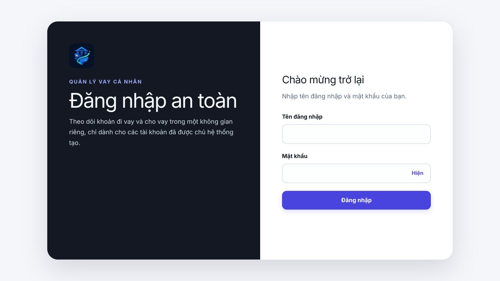
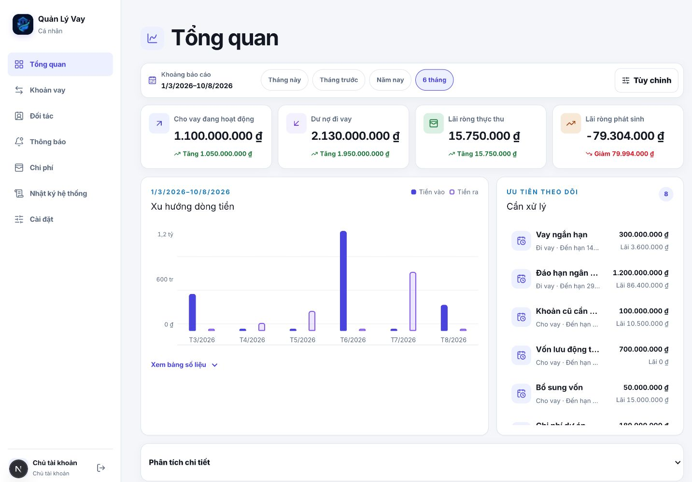
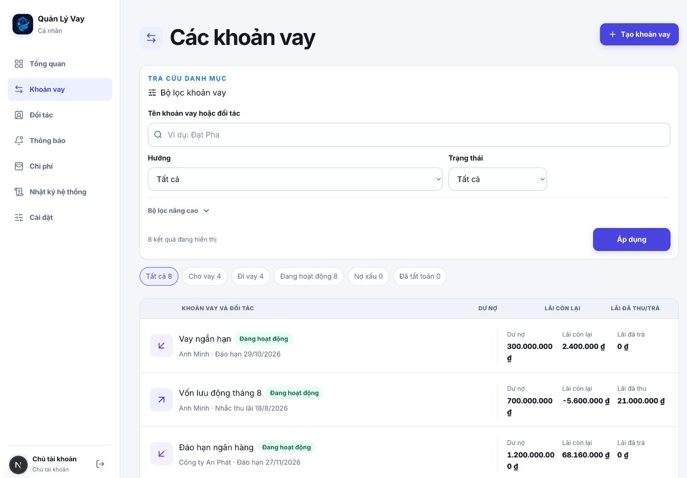
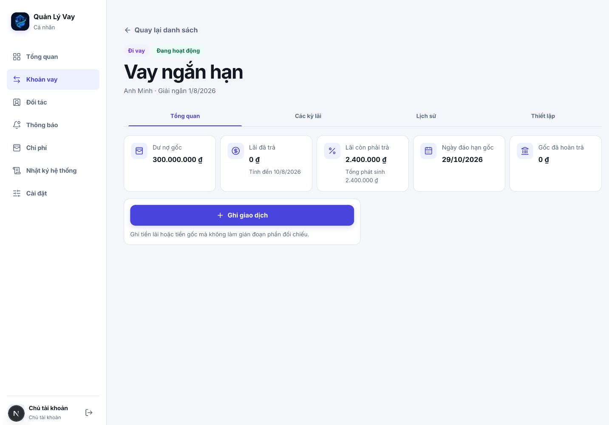
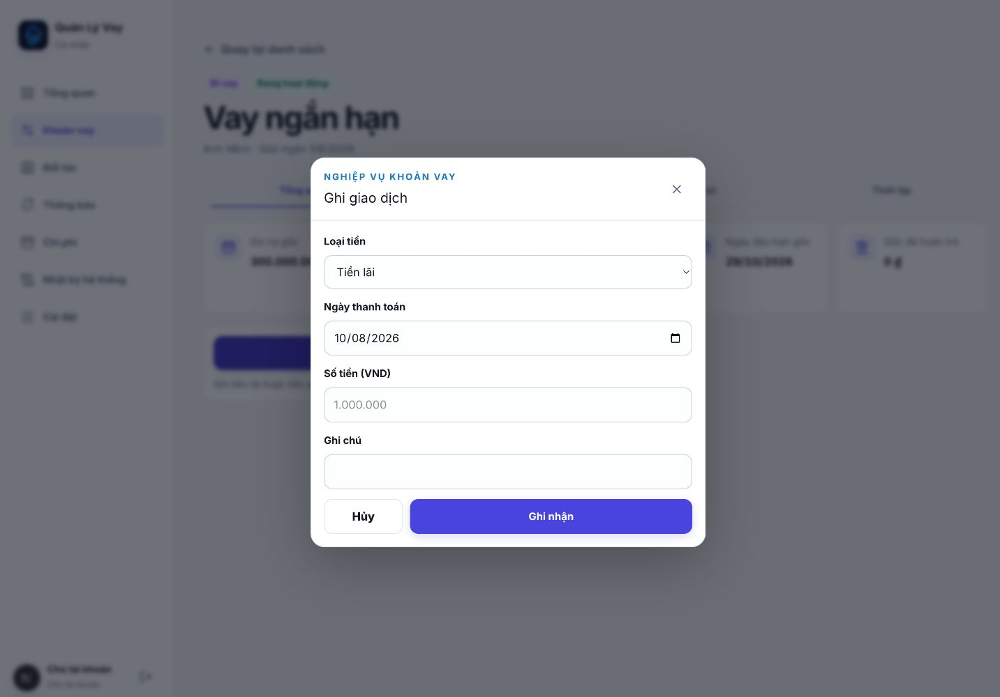
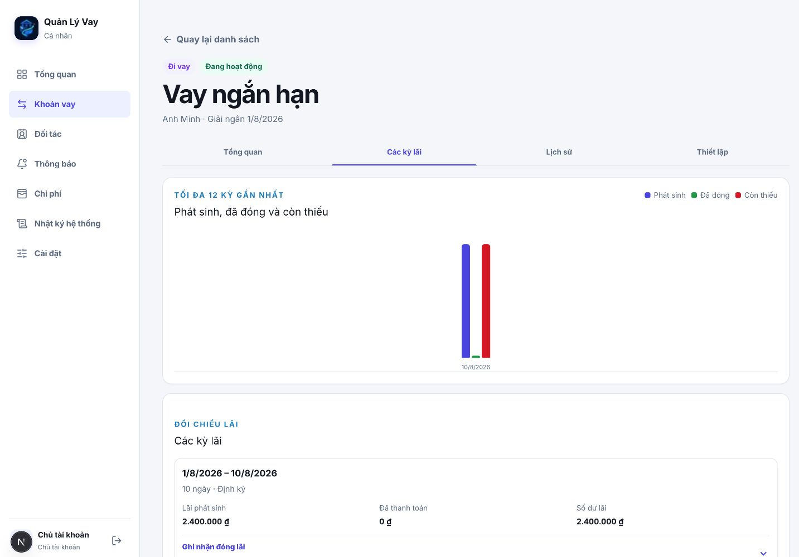
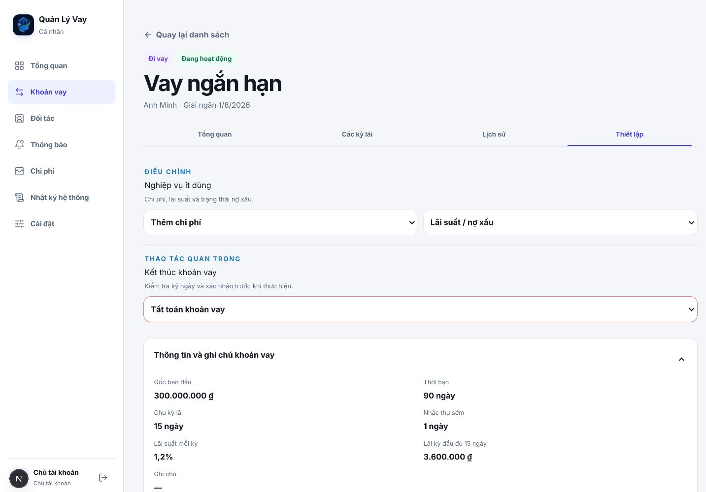

# Frontend UX/UI Audit — 10/08/2026

## Phạm vi và kết luận

- Bề mặt: bản Production ở màn đăng nhập; các màn sau đăng nhập dùng cùng source vừa deploy chạy
  local với tám khoản vay mô phỏng an toàn.
- Luồng: Đăng nhập → Tổng quan → Danh sách khoản vay → Chi tiết → Ghi giao dịch → Các kỳ lãi → Thiết lập.
- Kết luận: giao diện đã có nền tảng tốt và khá chỉn chu, nhưng cảm giác rối là có thật. Nguyên nhân
  chính không nằm ở bảng màu mà ở quá nhiều vùng/card có trọng lượng ngang nhau, mật độ số liệu không
  đều giữa các màn và mỗi module dùng một cách tổ chức thông tin khác nhau. Luồng ghi giao dịch là
  phần rõ ràng nhất; Dashboard và danh sách khoản vay cần được đơn giản hóa trước.

## Các bước và sức khỏe

### 1. Đăng nhập — Tốt

- Ưu: bố cục hai cột cân bằng, một hành động chính, nhãn form rõ, nhận diện thương hiệu nhất quán.
- Nhược: phần giới thiệu bên trái chiếm nửa màn hình nhưng chỉ có vài dòng; ở app cá nhân, diện tích
  này chưa tạo thêm giá trị hoặc niềm tin tương xứng.

### 2. Tổng quan — Cần cải tổ

- Ưu: bốn KPI quan trọng xuất hiện ngay; có bộ lọc thời gian, biểu đồ, danh sách cần xử lý và đường
  dẫn trực tiếp tới khoản vay.
- Nhược: bộ lọc, bốn KPI, biểu đồ và danh sách cần xử lý đều cạnh tranh chú ý. Chữ phụ và số so sánh
  nhỏ, nhiều màu trạng thái, trong khi hai cột lớn tạo cảm giác vừa dày vừa trống. Danh sách cần xử lý
  bị nhốt trong vùng cuộn riêng nên người dùng khó biết còn bao nhiêu mục bên dưới.
- Điều chỉnh theo phản hồi người dùng: giữ đủ bốn KPI ở đầu trang, giảm độ nổi của phần so sánh kỳ;
  đặt `Cần xử lý` ngay sau KPI và trước biểu đồ trong thứ tự đọc. Chuyển bộ lọc thành một control gọn
  và tránh vùng cuộn lồng nhau.

### 3. Danh sách khoản vay — Yếu nhất

- Ưu: tìm kiếm, lọc hướng/trạng thái và số lượng từng nhóm đều sẵn có; mỗi dòng là một link lớn.
- Nhược: filter card chiếm gần nửa first fold; dãy chip phía dưới lặp lại đúng các bộ lọc vừa có.
  Bốn cột dữ liệu làm tiền VND xuống dòng (`300.000.000` và `₫` tách nhau), nhãn cột lặp lại trong
  từng dòng và dấu hiệu ưu tiên/đến hạn chưa nổi bật.
- Đề xuất: dùng một thanh tìm kiếm + hai chip lọc, đưa nâng cao vào drawer. Mỗi dòng chỉ ưu tiên
  `Dư nợ` và `Hạn/lãi kế tiếp`; tổng lãi đã thu/trả chuyển vào detail hoặc tooltip. Không lặp nhãn
  cột trong từng row trên desktop.

### 4. Chi tiết khoản vay — Cấu trúc tốt, phân cấp yếu

- Ưu: breadcrumb, hướng, trạng thái và bốn tab rõ; dữ liệu authoritative dễ đọc.
- Nhược: năm card KPI có trọng lượng ngang nhau nên chưa trả lời nhanh “tôi cần làm gì tiếp theo?”.
  CTA `Ghi giao dịch` quá rộng nhưng đứng riêng, còn phần lớn màn hình trống. Tab trải toàn chiều rộng
  làm khoảng cách mắt lớn và chuyển tab có cảm giác tách màn.
- Đề xuất: tạo một summary hero gồm `Dư nợ`, `Lãi/hạn kế tiếp`, `Trạng thái`; đặt CTA cạnh hành động
  tiếp theo. Thu tab về một cụm gọn và giữ header khoản vay cố định khi chuyển tab.

### 5. Ghi giao dịch — Tốt nhất

- Ưu: một nhiệm vụ, thứ tự trường hợp lý, nhãn rõ, ngày mặc định, nút hủy/ghi nhận phân cấp tốt;
  dialog có tên truy cập được và focus đi vào nút đóng.
- Nhược: chưa có tóm tắt ngữ cảnh khoản vay/số dư trong modal; người dùng có thể phải nhớ số liệu ở
  màn phía sau.
- Đề xuất: thêm một dòng nhỏ `Khoản vay · Dư nợ · Lãi còn lại` phía trên form, không thêm card mới.

### 6. Các kỳ lãi — Quá nhiều diện tích cho ít thông tin

- Ưu: phân biệt phát sinh/đã đóng/còn thiếu; có hành động đóng lãi ngay tại kỳ.
- Nhược: biểu đồ cao 250 px ngay cả khi chỉ có một kỳ, tạo khoảng trống lớn. Ba số ở hàng kỳ bị dồn
  sát và có thể đọc nhầm `0 ₫ 2.400.000 ₫`; biểu đồ không giúp ra quyết định khi dữ liệu ít.
- Đề xuất: dưới ba kỳ thì dùng summary bar; chỉ hiện chart từ ba kỳ trở lên. Tách số dư lãi thành
  cột cuối có nền/trạng thái rõ và giữ khoảng cách giữa ba chỉ số.

### 7. Thiết lập — An toàn nhưng nặng nhận thức

- Ưu: nghiệp vụ ít dùng được thu gọn; thao tác tất toán có viền cảnh báo; thông tin hợp đồng vẫn
  đọc được trước khi sửa.
- Nhược: chi phí, lãi suất, nợ xấu, tất toán, sửa thông tin, onboarding và correction cùng nằm trong
  một trang dài. Nhiều accordion giống nhau khiến người dùng phải mở thử để tìm đúng thao tác.
- Đề xuất: chia thành `Thông tin khoản vay`, `Điều chỉnh`, `Kết thúc khoản vay`; chỉ OWNER thấy nhóm
  nghiệp vụ rủi ro. Dùng mô tả kết quả thay vì mô tả loại thao tác.

## Ưu điểm tổng thể

1. Visual system nhất quán: Inter, icon Lucide, màu cobalt và surface sáng sạch.
2. Navigation desktop ổn định; trạng thái hiện tại rõ và target thao tác đạt khoảng 44–48 px.
3. Semantic baseline tốt: skip link, landmark, heading, label form, dialog, `aria-current` và mô tả chart.
4. Có focus-visible và `prefers-reduced-motion`; modal có chuyển động vừa phải.
5. Luồng nghiệp vụ giữ ngôn ngữ tài chính rõ và không che giấu trạng thái quan trọng.

## Nhược điểm và ưu tiên

### P0 — Cảm giác không mượt chủ yếu là thiếu liên tục thị giác

- Browser automation mất khoảng 3,05–3,19 giây để xác nhận hoàn tất ba lần chuyển route, nhưng log
  Next.js của đúng các request warm chỉ mất 80–173 ms và không có console error. Vì vậy không thể quy
  kết backend chậm từ số đo browser này; phần đáng ngờ hơn là màn hình được tái bố cục rõ rệt giữa các
  route và thanh progress mảnh không giữ được cảm giác liên tục.
- Nên đo Production authenticated bằng Web Vitals/route timing để tách network/server/client. Về UX,
  giữ AppShell và nội dung cũ trong lúc route mới tải, dùng skeleton theo vùng và giảm thay đổi chiều
  cao/card giữa các màn thay vì thay toàn nội dung.

### P1 — Phân cấp thông tin

- Dashboard và list cho mọi thứ cùng độ nổi; người dùng phải tự quyết định đâu là việc cần làm.
- Nên thiết kế lại từ nhiệm vụ: `hôm nay cần thu/trả gì`, `khoản nào rủi ro`, rồi mới tới phân tích.

### P1 — Mật độ không nhất quán

- Dashboard/list quá dày; detail overview quá thưa; interest chart quá lớn; settings quá dài.
- Cần một density scale chung cho card, row, chart và form thay vì tối ưu từng màn riêng lẻ.

### P2 — Chữ phụ và độ tương phản

- Nhiều chữ 11–13 px màu xám nhạt, eyebrow viết hoa và icon trang trí cạnh tranh với dữ liệu.
- Cần kiểm tra contrast bằng công cụ; ảnh chụp chỉ cho thấy nguy cơ, chưa chứng minh vi phạm WCAG.

## Giới hạn bằng chứng

- Không dùng mật khẩu Production; các màn authenticated được chụp từ cùng code vừa deploy với dữ
  liệu local mô phỏng. Login và HTTP smoke được kiểm tra trực tiếp trên Production.
- In-app Browser không áp được viewport override 390×844 trong lần audit này, nên không dùng ảnh
  mobile sai kích thước làm bằng chứng. Code hiện có bottom navigation, target 54 px và responsive
  rules, nhưng cần một vòng capture mobile thật để kết luận về reflow/overflow.
- Chưa kiểm tra đầy đủ screen reader, thứ tự Tab, contrast tự động hoặc zoom 200%; không tuyên bố
  tuân thủ WCAG toàn diện.

## Hướng cải tổ đề xuất

1. Giai đoạn 1: giữ bốn KPI đầu Dashboard, sửa `Cần xử lý` thành danh sách actionable; rút list về
   task-first, bỏ chip/filter/card lặp và sửa wrap tiền VND.
2. Giai đoạn 2: gom detail thành summary hero + ba tab; chart thích ứng theo số kỳ; chia settings.
3. Giai đoạn 3: đo route Production authenticated, tối ưu loading/prefetch và QA mobile thật.
